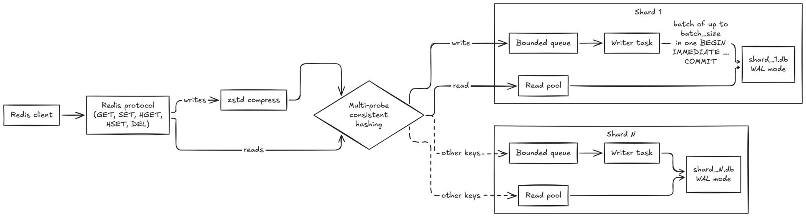
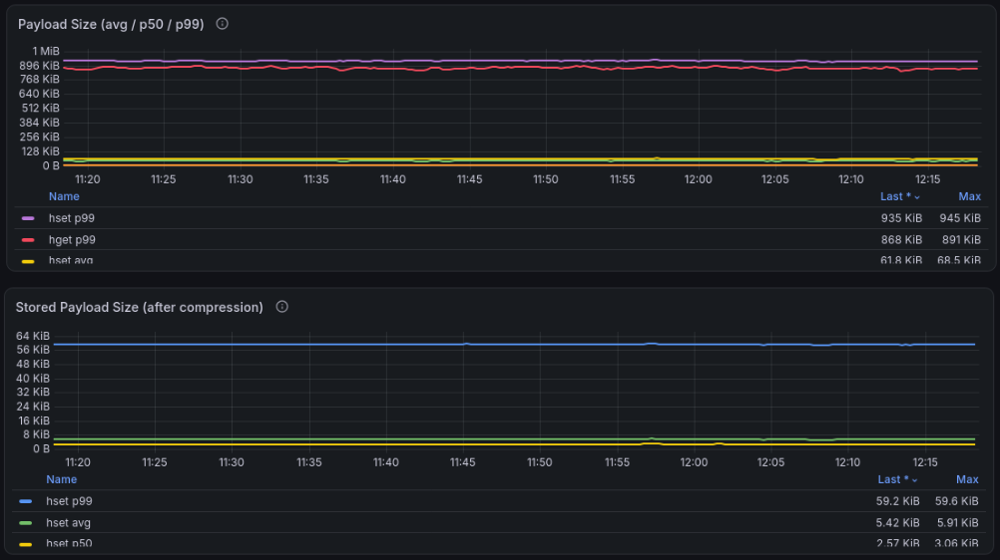
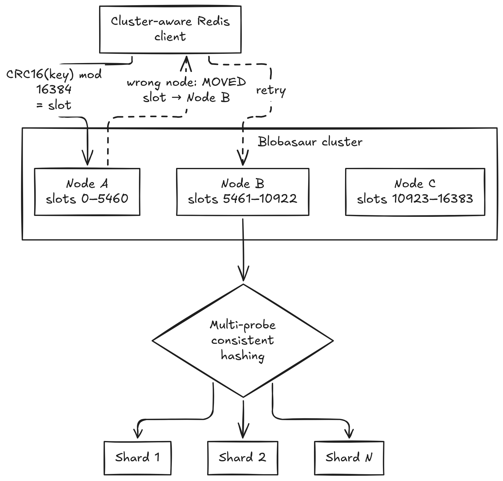
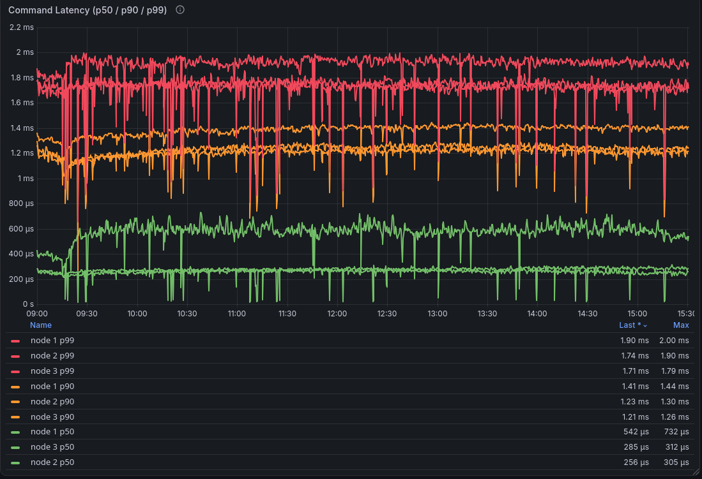
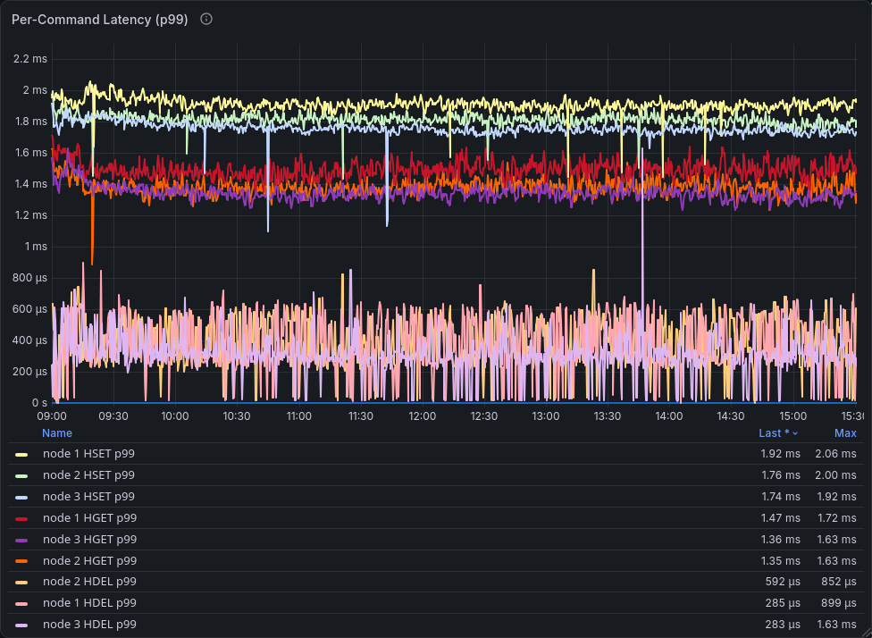

+++
title = "Distributed, high-performance blob storage on SQLite"
description = "How we built Blobasaur, a sharded, distributed, lightweight blob storage server to solve our high-throughput blob read/write usecase."
date = 2026-11-19T12:00:00+05:30

[taxonomies]
authors = ["sarat"]
tags = ["rust", "databases"]

[extra]
image = "/static/images/blobasaur-og.png"
+++

**TLDR;** We built Blobasaur, a sharded, distributed, lightweight blob storage server on top of SQLite to solve our high-throughput blob read/write usecase. JSON blobs varying from a few KBs to MBs are now written and read thousands of times per second on commodity hardware while maintaining single-digit millisecond latency.

-------------

On [Kite](https://zerodha.com/products/kite), our trading platform with ~20 million customers, users are able to customize their investment and trading screens heavily. They save multi-chart layouts, financial indicator templates, vector drawings, and various kinds of arbitrary UI preferences. In addition, we offer a Terminal mode that allows users to design their own workspaces by dragging, dropping, and customizing widgets. Under the hood, our backend services store these user preferences and metadata as opaque blobs (mostly JSON) ranging from a few kilobytes to several megabytes.

<!-- more -->

Many years ago, we stored such blobs in CouchDB, which turned out to be ill-suited for the kind of throughput we were starting to see. We then moved to SSDB ([ssdb](https://github.com/ideawu/ssdb)), a C++ disk-backed store that speaks the Redis protocol. This made it very easy to integrate as well. SSDB solved our immediate performance problems and ran reliably in production for several years.

Over time, two problems forced us to look for a replacement:

1. SSDB became unmaintained, which was an obvious operational risk. It is written in C++, which is not a part of our stack or expertise, so forking and maintaining was also not viable.
2. Scaling and size limits. SSDB is not a distributed system and can only run on a single node. This imposes significant future scaling challenges, including at one point forcing us to cap blob sizes at 1 MB because latency degrades on larger payloads.

As we added features like the Terminal mode and onboarded more internal services, we needed a robust solution. Our criteria were:

- A key-value blob store with a simple API.
- Designed for multi-megabyte blob read/write ops and high throughput. We sustain loads of thousands to tens of thousands of requests per second reading and writing arbitrary blobs. These are unpredictable and bursty thanks to the volatility in stock markets.
- Horizontally scalable, distributed.
- Disk-space efficiency / compression.
- Easily maintainable and highly economical.

So we investigated FOSS databases optimized for high-throughput blob storage and looked at the following:

- **ScyllaDB:** We already run ScyllaDB for high-throughput workloads, but in our tests, it turned out to be suboptimal for large blobs. Significantly lower throughput and higher resource usage. We specifically want multi-megabyte blobs. Tombstones from frequent overwrites and TTL expiries require careful tuning in ScyllaDB.
- **PostgreSQL:** We already have [considerable experience](https://zerodha.tech/blog/working-with-postgresql/) with Postgres in our stack and experimented with storing blobs as `BYTEA` columns, but it turned out to be severely suboptimal again for the use case in terms of performance and disk-space efficiency.
- **YugabyteDB:** Has blob storage as one of the options, but is not primarily designed or optimized for it. Also, a large system with too many features.
- **RocksDB:** Had the right primitives, but again, not architected for high throughput multi-MB blob writes.
- **Ceph:** Severe operational complexity and resource requirements. We didn't even get to trying it out.
- **SeaweedFS:** This was the closest candidate. However, there were a few blockers. Our use case is overwrite-heavy (a user changing their workspace) over the same key, and SeaweedFS keeps appending before compaction, which can cause disk usage to grow uncontrollably. Blobs have their own IDs, which then have to be mapped against user keys in a separate DB, adding another layer. It doesn't support TTL per blob. Also, reasonably complex setup with many parts.
- **S3 and MinIO:** Object storage has high per-request latency for small blobs, high request costs under write-heavy workloads (writes are 50% of our traffic), and coarse lifecycle TTLs instead of exact key expiry. Not to mention, S3 would incur significant costs given thousands of ops per second and tens of millions of ops per day.
- **Raw filesystem (one file per blob):** Putting blobs directly on disk meant implementing atomic writes and write batching, managing large numbers of files and directories, good old atomic read/write disk performance and inode headaches, and maintaining a separate metadata index for TTLs. Not to mention, orchestrating this over AWS storage volumes.

Around this time, we were toying with SQLite for another project and were marveling at its [*35% Faster Than The Filesystem*](https://www.sqlite.org/fasterthanfs.html) claim. We also happen to have a query cache system that creates [millions of tables](https://nadh.in/files/indiafoss-2024-dungbeetle.pdf) every day in a Postgres instance, which pushes the database to its limits quite successfully. Putting two and two together, we thought, why not build a system on top of SQLite to store millions of blobs and see what happens?

So we ended up building [Blobasaur](https://github.com/iamd3vil/blobasaur), an open source sharded blob server written in Rust that speaks the Redis protocol and uses SQLite as its storage engine. It is a single binary application that is high performance, and super simple to deploy and maintain. It is in production at Zerodha and it has successfully replaced SSDB.

<p class="align-center"><a href="https://github.com/iamd3vil/blobasaur"></a></p>


## What we needed

We had several Go and Python services already talking to SSDB via the Redis protocol, with more waiting to onboard. We wanted the new solution to meet these requirements:

- Redis protocol compatibility (if possible at all): Every existing client already used standard Redis libraries (`GET`, `SET`, `HGET`, `HSET`, `DEL`, `EXPIRE`). If we could get a system that could be a drop-in replacement, that would allow us to leave existing services untouched and reduce risk significantly.
- Low latency across payload sizes: It needed to serve both 2 KB settings blobs and 5 MB chart layouts with single-digit millisecond latency.
- Built-in compression: Almost all our payloads are repetitive JSON, which compresses well.
- Simple CRUD with TTLs: We didn't need complex data structures, server-side scripting, or secondary queries. We just needed key-value and hash CRUD with key expiry.
- Multi-node partitioning: We needed to split data across multiple machines so a single node wasn't a bottleneck.
- Relaxed durability is acceptable: This store holds non-critical UI and workspace preferences, and not critical financial data. If a sudden power loss drops recent writes, a user might lose a recent chart layout tweak, which is annoying, but it never affects trading. This was a good performance trade-off for our use case.

## Why SQLite (and Rust)

We had a few options for the storage. The obvious one is the raw filesystem, with one file per blob. But with that, we'd need to invent everything ourselves:

- Atomic writes and batching.
- TTL cleanup, which needs secondary indexes or walking the directories.
- Dealing with fd limits.
- Managing metadata separately from the raw data.

SQLite pretty much gave us everything that the raw filesystem lacked. For small blobs, SQLite is up to 35% faster than raw filesystem I/O. While raw files start to beat SQLite above ~100 KiB, we compress blobs before writing them. And thankfully, 99% of our compressed values sit well below 100 KiB.

Using SQLite also meant inheriting a battle-tested storage engine with ACID transactions, crash recovery, and standard tooling. Any shard on disk can be inspected with the standard `sqlite3` CLI or queried with plain SQL for analytics, etc.

While most of our backend stack is written in Go, we wrote Blobasaur in Rust. Go's standard SQLite driver requires CGo, which complicates static builds, pins OS threads during C calls under high concurrency, and adds garbage-collection pressure when allocating and compressing multi-megabyte buffers. With Rust (`sqlx`, `rusqlite`, and `tokio`), we call SQLite's C API directly with predictable memory usage and ship a single static binary.

## Architecture

### Splitting data into shards

In WAL (Write-Ahead Logging) mode, a single SQLite database allows concurrent readers, but still permits only one writer at a time. Since writes make up roughly 50% of our production traffic, a single SQLite file per node would bottleneck quickly.

To get write concurrency on a single machine, Blobasaur splits data across multiple SQLite database files on disk, called shards:

- Consistent hashing: Each key maps to one shard via multi-probe consistent hashing.
- Per-shard writer with group commit: Each shard has a dedicated writer task fed by a bounded queue. Instead of committing one key at a time, the writer drains a batch of pending writes from the queue and executes them inside a single `BEGIN IMMEDIATE ... COMMIT` transaction. This amortizes transaction and WAL overhead across concurrent clients.
- Concurrent readers: Reads go directly to a per-shard pool of read-only SQLite connections and can run concurrently with the writer.



### How much does sharding help?

We benchmarked 1 shard against 16 shards using a load generator opening 64 concurrent connections. Each request used a 64 KiB JSON blob payload (close to our production average), which zstd compresses roughly 9x.

All runs used 100,000 keys, synchronous writes, and `batch_size = 50`, with the data directory on `tmpfs` to isolate SQLite locking and CPU overhead from disk variance. Both setups received the same total resources: 1,600 MB of SQLite page cache and 64 total read connections.

| Workload | 1 shard | 16 shards |
| :---- | :---- | :---- |
| `HSET` only | 7,740 ops/s, p99 10.7 ms | 25,324 ops/s, p99 8.3 ms |
| 50% `HSET`, 50% `HGET` | 14,227 ops/s, p99 10.5 ms | 29,538 ops/s, p99 8.5 ms |
| `HGET` only | 67,128 ops/s, p99 2.1 ms | 70,884 ops/s, p99 2.3 ms |

With 16 shards, write throughput increases 3.3x and median write latency drops from 8.2 ms to 2.1 ms. Read throughput stays nearly identical because SQLite WAL mode already serves concurrent readers without contention.

At 25,324 `HSET` operations per second, each carrying a 64 KiB payload, Blobasaur processes roughly **1.66 GB/s of uncompressed JSON** through zstd. Both the server and load generator ran on the same 16-core laptop, sharing its CPU resources.

### Schema

Our services use both plain keys (`SET`/`GET`) and Redis hashes (`HSET`/`HGET`) to group blobs by service or feature (for example, `HSET prefs userID <json>`).

Inside each shard, plain keys live in a `blobs` table:

```sql
CREATE TABLE IF NOT EXISTS blobs (
    key TEXT PRIMARY KEY,
    data BLOB,
    created_at INTEGER NOT NULL,
    updated_at INTEGER NOT NULL,
    expires_at INTEGER,
    version INTEGER NOT NULL DEFAULT 0
);

CREATE INDEX IF NOT EXISTS idx_expires_at
    ON blobs(expires_at)
    WHERE expires_at IS NOT NULL;
```

`SET` writes to `blobs`. `HSET` writes to a table for its namespace, `blobs_<namespace>`, with the same columns. For example, `HSET prefs user42 ...` stores `user42` in `blobs_prefs`.

Expiry is stored in `expires_at` on the same row. Read queries filter out expired rows at read time (`expires_at IS NULL OR expires_at > ?`), while a background worker reaps expired rows asynchronously. Because the index on `expires_at` is a partial index (`WHERE expires_at IS NOT NULL`), rows without a TTL take up no space in the expiry index.

### Compression

Blobasaur supports zstd, lz4, gzip, and brotli compression before writing to SQLite. We run zstd in production.

Here is the compression ratio across one hour of production `HSET` traffic:

| `HSET` payload | Sent by the client | Stored in SQLite | Reduction |
| :---- | :---- | :---- | :---- |
| Average | 63.6 KiB | 5.5 KiB | about 11x |
| p99 | 935 KiB | 59.3 KiB | about 16x |

With SQLite's default 4 KiB pages, shrinking a 63.6 KiB payload to 5.5 KiB reduces its storage footprint from roughly 16 pages to roughly 2, before accounting for row and index overhead. Fewer pages holding blob data means less pressure on the page cache and less data to write through the WAL and into the database.



### Durability

Because we don't require strict durability for our specific use case of UI preferences, shards run in WAL mode with `PRAGMA synchronous = NORMAL`. SQLite does not fsync on every transaction commit. An OS crash or power loss can lose recent committed transactions that have not yet been synced to durable storage, while preserving database consistency.

For workloads that want even lower write latency, Blobasaur also supports an optional `async_write` mode that acknowledges writes as soon as they enter the shard's memory queue, before the SQLite batch commits.

### Scaling across machines

To scale beyond a single server, Blobasaur implements the Redis Cluster protocol, making it compatible with standard cluster-aware Redis clients. Like Redis Cluster, the keyspace is divided into 16384 hash slots using `CRC16`. Each Blobasaur node owns a configured range of slots, and nodes discover each other via gossip. If a client sends a key to the wrong node, the node responds with a `MOVED` redirect pointing to the owner node.



This gives Blobasaur two-level routing:

1. Cluster level: `CRC16(key) % 16384` selects the machine.
2. Node level: Multi-probe consistent hashing selects the SQLite shard on that machine.

There are some limitations right now. At present, slot assignment is static in config. Live slot rebalancing between running nodes and automatic failover are not implemented yet.

### Changing the number of shards

We chose multi-probe consistent hashing so resharding a node only has to move minimal data, without needing virtual nodes. With naive `hash % num_shards`, increasing from 4 to 5 shards moves ~80% of keys. With consistent hashing, only ~20% of keys move (the share belonging to the new shard).

Resharding is currently an offline operation via the built-in CLI:

1. Stop the server.
2. Run `blobasaur shard migrate 4 5 --verify`.
3. Update `num_shards` in `config.toml` and start the server.

The migration tool moves keys whose target shard changed. With `--verify`, it checks that keys are in the expected shards and reports post-migration row counts.

## Moving off SSDB

We rolled out Blobasaur in a phased deployment strategy:

1. New workloads first: When we launched Kite Terminal mode, we pointed its workspace storage directly at Blobasaur.
2. Dual-write and backfill: For existing workloads like chart preferences, we updated the services to dual-write to both SSDB and Blobasaur while running a background migration for historical keys. Reads went to Blobasaur first and fell back to SSDB on a cache miss or error.
3. Cutover: On the client side, the only code change was switching from a single-node Redis client to a Redis Cluster client with the three Blobasaur node IPs.

After running dual-writes for a month with zero discrepancies, we turned off SSDB.

## What we learned along the way

### Deleting rows doesn't shrink SQLite files {#deleting-rows-doesnt-shrink-sqlite-files}

Early on, we noticed disk usage only grew, even after millions of keys expired or were deleted. By default, SQLite keeps freed pages on an internal freelist for future writes rather than returning space to the OS.

To fix this, we enabled `PRAGMA auto_vacuum = INCREMENTAL` across every shard and added a `blobasaur shard vacuum` subcommand to reclaim unused freelist pages within a set allocation (128 MB default). Since shrinking the actual database file in WAL mode requires a checkpoint, Blobasaur runs `PRAGMA wal_checkpoint(TRUNCATE)` right after executing an incremental vacuum.

### Async writes have to be visible to every read

When `async_write` is enabled, a write returns `OK` while still sitting in the shard's memory queue waiting for the next batch commit. To preserve read-your-writes consistency, queued writes are also placed in an in-memory pending map that reads check before querying SQLite.

During testing, we hit edge cases where certain read and existence-check paths bypassed this pending map or didn't account for deletes. For example, a `DEL` followed immediately by a `GET` could return the old value from SQLite because the queued `DEL` hadn't committed yet. We fixed this by storing explicit tombstones in the pending map and routing every read (`GET`, `HGET`, `EXISTS`, `TTL`) through it first.

### Expiry cleanup has to share the writer

In production, our p99 write latency normally sat below 5 ms, but we occasionally saw spikes to 30 to 50 ms.

We traced the spikes to the background TTL cleanup task. Initially, the cleanup worker opened its own write connection and ran a single large `DELETE` statement for all expired rows. That large `DELETE` contended with the shard's main writer for SQLite's single write lock, stalling normal client batches.

We fixed this in two ways: routing cleanup batches through the shard's existing writer connection so they take turns cleanly with client writes, and bounding each pass with `cleanup_chunk_size` (1,000 rows by default). Since expired rows are already filtered out at read time, spreading physical deletion across smaller chunks eliminated the latency spikes without affecting correctness.

## In production

Our current Blobasaur deployment runs as a three-node (4 vCPU, 8 GB RAM) cluster. Over a full trading session (09:00 to 15:30), p99 latency across all commands stays around 2 ms on every node, and p50 sits between 250 and 550 µs.



Broken down by command, `HSET` p99 sits around 2 ms, `HGET` p99 around 1.4 ms, and `HDEL` p99 mostly under 1 ms.



---

Blobasaur is open source under the AGPLv3 license and available on GitHub [@iamd3vil/blobasaur](https://github.com/iamd3vil/blobasaur). Find other projects from the Zerodha.tech hacker collective at [4th Cross Labs](https://fourthcross.tech).
